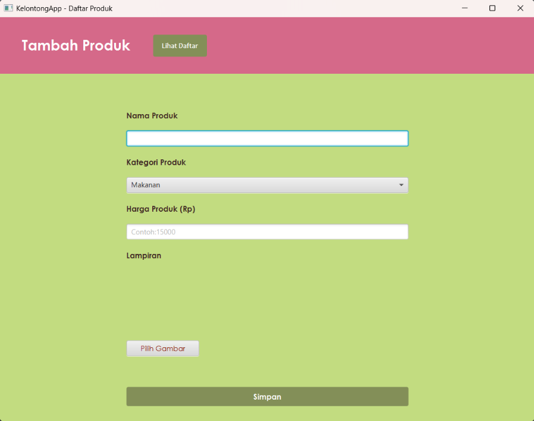
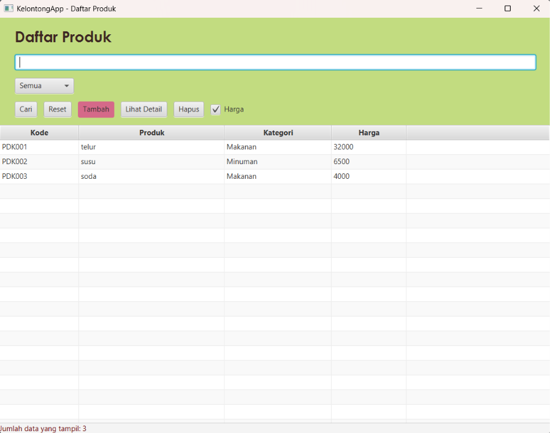
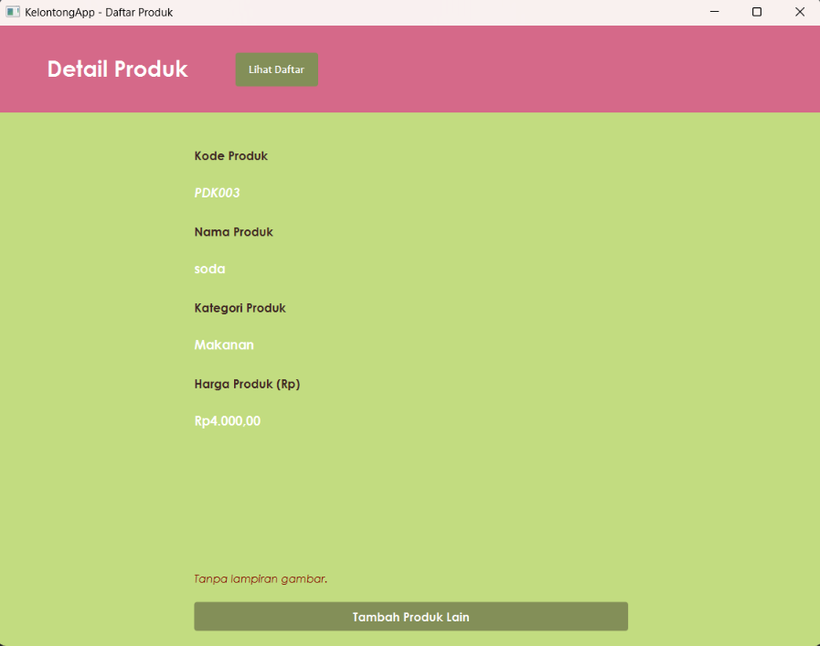

# KelontongApp

Aplikasi desktop pencatatan produk toko kelontong berbasis **JavaFX** dan **Maven**. Pengguna dapat menambahkan produk (lengkap dengan gambar lampiran), melihatnya dalam tabel, mencari dan memfilter produk, melihat detail, serta menghapusnya. Data disimpan di memori selama aplikasi berjalan (tanpa database). Proyek ini dibuat untuk memenuhi tugas mata kuliah Pemrograman Lanjut dengan menerapkan prinsip Object-Oriented Programming (OOP) dan pola arsitektur MVC (Model-View-Controller).

## Fitur Utama

- **Tambah Produk**: Form untuk mengisi nama produk, kategori (Makanan atau Minuman), harga, dan gambar lampiran (opsional). Kode produk dibuat otomatis oleh sistem dengan format `PDK001`, `PDK002`, dan seterusnya.
- **Tabel Daftar Produk**: Menampilkan kode, nama, kategori, dan harga setiap produk.
- **Pencarian & Filter**: Pencarian berdasarkan kode atau nama produk lewat tombol **Cari**, dengan filter kategori (Semua, Makanan, Minuman) dan tombol **Reset**. Kolom Harga bisa disembunyikan dengan checkbox **Harga**.
- **Lihat Detail**: Menampilkan kode, nama, kategori, harga, dan gambar produk yang dipilih. Halaman detail menerima objek produk yang diklik di tabel.
- **Hapus Produk**: Menghapus produk yang dipilih setelah dikonfirmasi lewat dialog.
- **Validasi Input & Penanganan Eksepsi**:
  - Nama produk tidak boleh kosong.
  - Kategori harus Makanan atau Minuman.
  - Harga harus bilangan bulat lebih dari nol (`NumberFormatException` dan `IllegalArgumentException` ditangani dengan pesan di layar).
  - Gambar harus berformat PNG atau JPEG dengan ukuran maksimum 5 MB.

## Teknologi

- Java dengan JavaFX 21 (`javafx-controls`, `javafx-fxml`)
- Maven
- Apache NetBeans IDE
- Scene Builder (untuk mendesain tampilan FXML)

## Kebutuhan

- JDK (versi yang sama dengan `maven.compiler.release` di `pom.xml`)
- Apache NetBeans IDE (sudah termasuk Maven)
- Koneksi internet saat build pertama, agar Maven mengunduh dependensi JavaFX

## Cara Menjalankan

1. Clone repository:
   ```
   git clone https://github.com/chaavier/kelontongApp.git
   ```
   (Membutuhkan Git. Alternatifnya, klik tombol **Code > Download ZIP** di halaman repository, lalu ekstrak.)

2. Buka Apache NetBeans IDE, lalu pilih menu **File > Open Project...** dan arahkan ke folder proyek `KelontongApp`.

3. Klik kanan pada nama proyek di panel **Projects**, lalu pilih **Clean and Build** (`Shift + F11`) agar Maven mengunduh seluruh dependensi JavaFX.

4. Untuk menjalankan aplikasi:
   - Klik kanan pada nama proyek, pilih **Run Maven > Goals...**, isi `javafx:run`, lalu klik **OK**.
   - Atau lewat terminal di folder proyek: `mvn clean javafx:run` (membutuhkan Maven terpasang).

## Cara Menggunakan

1. Di halaman **Tambah Produk**, isi nama, pilih kategori, isi harga, lalu (opsional) klik **Pilih Gambar**. Klik **Simpan**.
2. Klik **Lihat Daftar** untuk melihat semua produk dalam tabel.
3. Ketik kode atau nama di kolom pencarian lalu klik **Cari**, atau pilih kategori pada filter.
4. Pilih satu baris lalu klik **Lihat Detail** untuk membuka halaman detail, atau **Hapus** untuk menghapus produk.

## Screenshot







## Struktur Proyek

```
KelontongApp/
├── pom.xml
└── src/main/
    ├── java/kelas/
    │   ├── MainApp.java              # titik masuk aplikasi
    │   ├── Navigator.java            # perpindahan antar halaman
    │   ├── controller/
    │   │   ├── FormController.java
    │   │   ├── DaftarController.java
    │   │   └── DetailController.java
    │   ├── data/
    │   │   └── DataPenambahanProduk.java   # penyimpanan data di memori
    │   └── model/
    │       ├── Produk.java
    │       └── Penambahan.java
    └── resources/fxml/
        ├── form.fxml
        ├── daftar.fxml
        └── detail.fxml
```

## Catatan

- Data tidak disimpan permanen. Semua produk hilang saat aplikasi ditutup.
- Gambar hanya menyimpan lokasi file di komputer. Jika file dipindah atau dihapus, gambar tidak akan tampil di halaman detail.

## Pembuat

Raissa Javier Aurellia (2503348)
